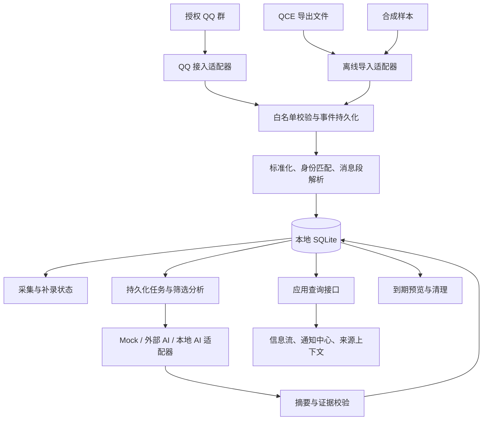

# 技术架构草案 v0.1

2026-10-10，TASK-003 / TASK-004。总体架构仍为提议；M0 离线 CLI 已按 DEC-015 授权实现，实际选型见 DEC-016。src/qq_radar/domain.py、storage.py、ingestion.py、cli.py 分别负责规范化、存储查询、事务导入和命令；后续服务模块尚未实现。组件证据见 [component_review.md](component_review.md)。

TASK-013 增量：demo.py 生成明确标注的合成阅读样本，server.py 提供本机只读接口，web/ 下原生页面展示来源与导入状态；复用现有 storage 查询，无 schema 升级。http.server 只用于本机体验（DEC-018），后续生产 API / worker / 外部组件方案仍为提议。



## 进程与职责

M0 使用 Python 标准库和 SQLite 完成离线 CLI，无网络依赖。后续 FastAPI 查询服务与单个任务 worker 可分进程运行在同一主机；QQ 接入独立运行，不把分析逻辑写入其插件内部。浏览器界面先普通 HTML / CSS / JavaScript，减少首版构建和部署复杂度。

数据库位于本机磁盘，短事务、有限批次写入，明确 busy / 超时处理。正常化、分析、补录分开记录进度；数据库提交失败不推进检查点。队列积压需显示，不能让 AI 调用阻塞实时消息处理。

首次接入选择正向 WS 作为验证起点；反向 WS 可后续适配。传输重连不能替代历史恢复。对 WS 数据在本地持久化前崩溃的窗口，必须依靠上游可回查范围及人工对照，不能保证 exactly-once 上游传递。

## 模块草案

```text
src/qq_radar/
  cli.py           # 离线导入、回放与查询
  adapters/        # 合成样本 / QCE / OneBot 输入与能力声明
  ingestion/       # 白名单、批次、观测记录与匹配
  domain/          # 消息、段、身份、来源与状态
  storage/         # SQLite、schema 版本及迁移
  integrity/       # 断线区间、恢复尝试与覆盖证据
  analysis/        # 规则、主题、provider 与摘要证据
  jobs/            # 任务租约、重试、窗口与补算
  api/             # 查询和用户操作
  retention/       # 清理预览、确认规则与执行
  web/             # 页面与静态资源
```

模块按增量建立，不预先填空实现。M0 首先建立 domain / storage / ingestion / cli 和相关测试。

## 关键行为约定

- 原始观测、标准化消息、分析结果各有独立状态。过滤只影响分析输入，在保留期限内仍可查看原文及处理原因。
- 转发子节点采用本地父消息 + 节点路径标识；不假装子节点属于当前群，也不自动宣称可跳转原群。
- 图片段缺少文本时列为待媒体处理；不能因为文本为空就标记无价值。链接第一版只分析消息中的文字和 URL，不自动抓取网页。
- hourly / daily 使用 Asia/Shanghai 的日历窗口，存储 UTC 时间；迟到消息产生补算版本，不重复通知已发送的相同结果。
- 分析任务写入数据库并有租约；失败重试与接管可复现；预算、provider 与 prompt 版本进入运行记录。
- 模型结果必须引用本批次有效消息 / 子节点证据；无效 ID 标记失败，不展示伪造来源。网页按纯文本安全渲染聊天和模型内容。
- 删除规则作用于正文、原始观测、附件、搜索索引与派生缓存。摘要中的原文摘录也要按批准策略处理，避免通过另一张表无限保留正文。收藏不自动豁免。

## 部署与资源

Windows 本地开发完成后再测云端单机。约 30,000 / 天折合均值约 0.35 条 / 秒，仅用于解释平均规模；峰值必须独立测试。原文储量约为“日量 × 平均记录字节 × 天数”，媒体另算；40 GB 磁盘还需容纳系统、QQ、日志、WAL 和临时导出文件。

先不引入 PostgreSQL、Redis、向量数据库和机器人聊天框架。只有实测出现多 writer 竞争、检索需求或资源限制时再提交升级方案。跨机器访问 SQLite 文件不在本草案范围；远端只通过应用接口访问。

## 选型状态

Python 标准库 + SQLite 已用于 M0，实测版本与许可见 DEC-016；TASK-013 本机体验服务见 DEC-018；FastAPI 推荐用于后续生产 API；NapCat / QCE 推荐先验证。真实组件许可适用范围与 QQ 兼容矩阵未完成，不能将此草案当作安装配置。离线合成回放性能记录仅见 task004_validation.md，不代表生产容量。
