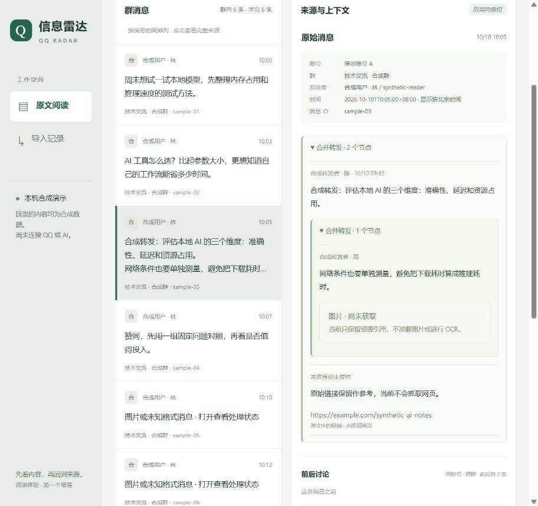

# TASK-013 来源阅读增量验证记录

2026-10-10。关联 TASK-007、TASK-011；REQ-003、009、010、015、017、018。环境为 Windows 11、Python 3.14.7、SQLite 3.50.4。乙方实现验证通过，甲方尚未体验验收。

## 可复现自动化验证

`python -m unittest discover -s tests -v`：15 项通过，包含 TASK-004 原有 10 项与 tests/test_web.py 的 5 项 HTTP 回归。HTTP 使用临时合成库、随机本机端口，执行后关闭服务、清理临时文件。

最终 `python -m compileall -q src tests qq_bot.py` 与 `git diff --check` 通过；24 份 Markdown 文档的本地相对链接核对无断链。最终实际页面浏览器 error / warn 日志为空。合成演示截图见下图，截图由运行中的页面直接取得：

| 检查 | 结果 |
| --- | --- |
| 合成演示与重导 | 首轮 12 seen / 8 inserted / 1 matched / 2 failed / 1 excluded；重导 0 inserted / 9 matched / 2 failed / 1 excluded；两条错误分别在第 10、11 行 |
| 消息查询与来源 | 群 / 账号隔离、分页 next_offset、关键词匹配转发；转发原始结构及同群前后各 2 条对应合成输入 |
| 无效输入与路径 | 缺少查询范围、重复参数、非法时间、分页越界返回 400；未知 ID / 文件路径返回 404；POST 返回 405 |
| 只读与请求边界 | 查询前后数据库文件字节不变；Host / Origin / cross-site 拒绝；固定静态映射，no-store、CSP、nosniff 响应头 |
| 启动限制 | 缺失库不创建；非 synthetic.v1 namespace 的库拒绝启动 |

## 实际浏览器验证

用 Codex 浏览器操作本机服务，读取界面状态并检查截图；浏览器验证属于本轮人工操作证据，不宣称已建立自动化端到端测试套件。

- 默认群调整为当前账号消息最多的群，演示首次打开即可看到完整阅读例子。
- 选择 sample-03，看到 2 节点转发及内部 1 节点转发、来源人 / 时间、未获取图片；折叠与展开有效，前后文保持在同账号同群。
- 搜索“网络条件”只显示包含该转发子文本的消息；不存在关键词显示明确空结果提示。
- 切换账号 B，只显示该账号独立的 sample-02，详情重置。
- 导入记录实际显示 12 已处理、8 新增、1 匹配、2 失败、1 排除；第 10 行身份冲突、第 11 行无效 JSON，失败正文不显示。
- tests/prepare_browser_qa.py 生成独立 data/browser-qa.db：25 条分页样本实际分为 20 / 5，末页下一页禁用，回到第一页恢复 20 条。
- qa-00 包含 script / img / onerror 标签文字，在列表、完整原文及上下文中保持纯文本；详情不存在注入的 img / script 元素，没有 JS 弹窗。
- 390 像素视口配置下采用上下布局，页面 clientWidth 与 scrollWidth 均为 375（扣除滚动条），未横向溢出；折叠转发后再检查一致。恢复默认视口后重新加载演示。

边界测试复现：先执行 `python tests/prepare_browser_qa.py`，再执行 `python qq_bot.py --db data/browser-qa.db serve --port 8766`，浏览器切换 synthetic-qa-account。该服务仅测试用，验证后停止；不将 QA 库或真实数据提交。

本轮未测实际手机设备、所有浏览器、长时并发与生产网络。服务 / 数据均为本机合成演示，没有 QQ / AI / 通知外发，也没有删除正文或摘要。TASK-007 整体和 TASK-011 全部场景仍未完成，TASK-013 仅交付可操作的来源阅读子集。
